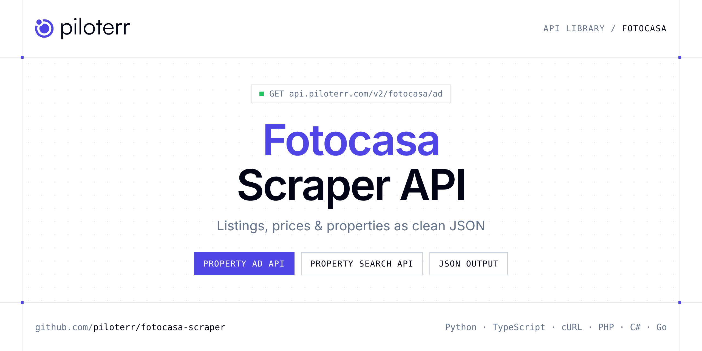

<p align="center">
  <a href="https://www.piloterr.com"></a>
</p>

# Fotocasa Scraper API

[](https://discord.gg/CFj3ph8aHU) [](https://app.piloterr.com) [](https://app.piloterr.com/openapi) [](LICENSE)

The **Piloterr Fotocasa Scraper API** lets you extract public data from Fotocasa as **clean, structured JSON** — no proxies, headless browsers or HTML parsing to maintain. Endpoints available in production:

- **Fotocasa Property Ad API** — Get a full Fotocasa listing by URL: price, features, coordinates, energy certificate, images, and agency (browser rendering, 2 credits).
- **Fotocasa Property Search API** — Search Fotocasa listings by city or search URL.

Use it for property price monitoring, market analytics, investment sourcing or rental yield models.

| Endpoint | Path | Credits | What you get |
|---|---|---|---|
| [Fotocasa Property Ad API](#fotocasa-property-ad-api) | `/v2/fotocasa/ad` | 2 | Get a full Fotocasa listing by URL |
| [Fotocasa Property Search API](#fotocasa-property-search-api) | `/v2/fotocasa/search` | 2 | Search Fotocasa listings by city or search URL. Returns prices, rooms, area, coordinates, and agency data via browser rendering (2 credits). |

## Table of contents

- [How it works](#how-it-works)
- [Fotocasa Property Ad API](#fotocasa-property-ad-api)
- [Fotocasa Property Search API](#fotocasa-property-search-api)
- [Code examples in other languages](#code-examples-in-other-languages)
- [Practical use cases](#practical-use-cases)
- [Why Piloterr?](#why-piloterr)
- [FAQ](#faq)
- [Related scrapers](#related-scrapers)
- [Support](#support)

## How it works

1. **Create a free Piloterr account** and copy your API key from the [dashboard](https://app.piloterr.com).
2. **Send a `GET` (or `POST`) request** to `https://api.piloterr.com/v2/...` with the header `x-api-key: YOUR_API_KEY`.
3. **Receive structured JSON** — Piloterr handles rendering, proxies, retries and parsing.

```bash
export PILOTERR_API_KEY="your-api-key"
pip install requests        # Python
# TypeScript: Node.js 18+ (native fetch), run with `npx tsx file.ts`
```

> Every endpoint accepts both `GET` (query string) and `POST` (JSON body with the same fields).

## Fotocasa Property Ad API

Get a full Fotocasa listing by URL: price, features, coordinates, energy certificate, images, and agency (browser rendering, 2 credits).

`GET | POST https://api.piloterr.com/v2/fotocasa/ad` · **2 credits per request** · [Full reference](https://app.piloterr.com/openapi)

### Request parameters

| Parameter | Type | Required | Description |
|---|---|---|---|
| `query` | string | ✅ | Full Fotocasa ad URL (`/comprar/` or `/alquiler/`, ending with `/d`). |

### Python example

```python
import json
import os
import requests

response = requests.get(
    "https://api.piloterr.com/v2/fotocasa/ad",
    headers={"x-api-key": os.environ["PILOTERR_API_KEY"]},
    params={
        "query": "https://www.fotocasa.es/es/comprar/vivienda/madrid-capital/aire-acondicionado-calefaccion-terraza-ascensor-amueblado/190589697/d",
    },
    timeout=60,
)
response.raise_for_status()
data = response.json()

print(json.dumps(data, indent=2, ensure_ascii=False)[:2000])
```

### TypeScript example

```typescript
type FotocasaPropertyAd = {
  id?: string;
  url?: string;
  media?: {
    images?: string[];
    thumbnail_url?: string;
  };
  price?: {
    amount?: number;
    currency?: string;
    price_drop?: unknown;
    price_per_m2?: number;
  };
  title?: string;
  agency?: {
    url?: string;
    name?: string;
    type?: string;
    alias?: string;
    phone?: string;
  };
  status?: string;
  features?: {
    floor?: string;
    rooms?: number;
    extras?: string[];
    area_m2?: number;
    bathrooms?: number;
    furnished?: boolean;
    has_heating?: boolean;
    has_parking?: boolean;
    has_terrace?: boolean;
    orientation?: string;
    has_elevator?: boolean;
    energy_certificate?: string;
    has_air_conditioning?: boolean;
  };
  location?: {
    city?: string;
    address?: string;
    district?: string;
    latitude?: number;
    province?: string;
    longitude?: number;
    postal_code?: string;
    neighborhood?: string;
  };
  operation?: string;
  reference?: string;
  description?: string;
  published_at?: string;
  property_type?: string;
  energy_certificate?: {
    emissions?: string;
    efficiency?: string;
    emissions_value?: number;
    efficiency_value?: number;
  };
};

const params = new URLSearchParams({
  "query": "https://www.fotocasa.es/es/comprar/vivienda/madrid-capital/aire-acondicionado-calefaccion-terraza-ascensor-amueblado/190589697/d",
});

const response = await fetch(`https://api.piloterr.com/v2/fotocasa/ad?${params}`, {
  headers: { "x-api-key": process.env.PILOTERR_API_KEY! },
});
if (!response.ok) throw new Error(`Piloterr error ${response.status}: ${await response.text()}`);

const data = (await response.json()) as FotocasaPropertyAd;

console.log(JSON.stringify(data, null, 2).slice(0, 2000));
```

<details>
<summary><b>POST variant</b></summary>

```http
POST https://api.piloterr.com/v2/fotocasa/ad
x-api-key: YOUR_API_KEY
Content-Type: application/json

{"query": "https://www.fotocasa.es/es/comprar/vivienda/madrid-capital/aire-acondicionado-calefaccion-terraza-ascensor-amueblado/190589697/d"}
```
</details>

### Output example

Example response from the API reference, abridged — real values depend on the page you scrape.

```json
{
  "id": "190589697",
  "url": "https://www.fotocasa.es/es/comprar/vivienda/madrid-capital/aire-acondicionado-calefaccion-terraza-ascensor-amueblado/190589697/d",
  "media": {
    "images": [
      "https://static.fotocasa.es/images/ads/0fe8c038-bcae-4028-aa77-840986d1562d?rule=original",
      "https://static.fotocasa.es/images/ads/c41d1c6c-a6b8-4c66-8957-6986220698a8?rule=original"
    ],
    "thumbnail_url": "https://static.fotocasa.es/images/ads/0fe8c038-bcae-4028-aa77-840986d1562d?rule=original"
  },
  "price": {
    "amount": 244000,
    "currency": "EUR",
    "price_drop": null,
    "price_per_m2": 4692
  },
  "title": "Apartamento en venta en Calle de Zabalza, Simancas, Madrid Capital",
  "agency": {
    "url": "https://www.fotocasa.es/es/inmobiliaria--vohome-julián-camarillo---simancas/comprar/viviendas/espana/todas-las-zonas/l",
    "name": "VO HOME JULIAN CAMARILLO - SIMANCAS",
    "type": "professional",
    "alias": "VOhome Julián Camarillo - Simancas",
    "phone": "example"
  },
  "status": "active",
  "features": {
    "floor": "4ª planta",
    "rooms": 2,
    "extras": [
      "Aire acondicionado",
      "Calefacción"
    ],
    "area_m2": 52,
    "bathrooms": 1,
    "furnished": true,
    "has_heating": true,
    "has_parking": false,
    "has_terrace": true,
    "orientation": "Noreste",
    "has_elevator": true,
    "energy_certificate": "F",
    "has_air_conditioning": true
  },
  "location": {
    "city": "Madrid",
    "address": "Calle de Zabalza",
    "district": "San Blas",
    "latitude": 40.42925376395859,
    "province": "Madrid",
    "longitude": -3.624235493745569,
    "postal_code": "28037",
    "neighborhood": "Simancas"
  },
  "operation": "sale",
  "reference": "145",
  "description": "VOhome Propiedades Simancas vende piso ubicado en Calle Zabalza en el barrio de Simancas.\r\n\r\nEsta acogedora vivienda se distribuye a trav…",
  "published_at": "2026-08-28T14:03:58.087",
  "property_type": "apartment",
  "energy_certificate": {
    "emissions": "E",
    "efficiency": "F",
    "emissions_value": 61,
    "efficiency_value": 328
  }
}
```

### Response fields

| Field | Type | Description |
|---|---|---|
| `id` | string |  |
| `url` | string |  |
| `media` | object |  |
| `media.images` | string[] |  |
| `media.thumbnail_url` | string |  |
| `price` | object |  |
| `price.amount` | integer |  |
| `price.currency` | string |  |
| `price.price_drop` | object |  |
| `price.price_per_m2` | integer |  |
| `title` | string |  |
| `agency` | object |  |
| `agency.url` | string |  |
| `agency.name` | string |  |
| `agency.type` | string |  |
| `agency.alias` | string |  |
| `agency.phone` | string |  |
| `status` | string |  |
| `features` | object |  |
| `features.floor` | string |  |
| `features.rooms` | integer |  |
| `features.extras` | string[] |  |
| `features.area_m2` | integer |  |
| `features.bathrooms` | integer |  |
| `features.furnished` | boolean |  |

## Fotocasa Property Search API

Search Fotocasa listings by city or search URL. Returns prices, rooms, area, coordinates, and agency data via browser rendering (2 credits).

`GET | POST https://api.piloterr.com/v2/fotocasa/search` · **2 credits per request** · [Full reference](https://app.piloterr.com/openapi)

### Request parameters

| Parameter | Type | Required | Description |
|---|---|---|---|
| `query` | string | ✅ | City name or full Fotocasa search URL. |
| `operation` | string | — | Used when `query` is a city name (ignored for full URLs). |
| `page` | number | — | Page number (1-based). Default: `1`. Page 2 maps to `/l/2`. |

### Python example

```python
import json
import os
import requests

response = requests.get(
    "https://api.piloterr.com/v2/fotocasa/search",
    headers={"x-api-key": os.environ["PILOTERR_API_KEY"]},
    params={
        "query": "madrid",
    },
    timeout=60,
)
response.raise_for_status()
data = response.json()

print(json.dumps(data, indent=2, ensure_ascii=False)[:2000])
```

### TypeScript example

```typescript
type FotocasaPropertySearch = {
  meta?: {
    location?: string;
    operation?: string;
    total_pages?: number;
    current_page?: number;
    has_next_page?: boolean;
    total_results?: number;
  };
  listings?: {
    id?: string;
    url?: string;
    city?: string;
    floor?: unknown;
    price?: number;
    rooms?: number;
    title?: string;
    address?: string;
    area_m2?: number;
    currency?: string;
    latitude?: number;
    bathrooms?: number;
    longitude?: number;
    operation?: string;
    price_drop?: unknown;
    agency_name?: string;
    neighborhood?: string;
    price_per_m2?: number;
    published_at?: string;
    property_type?: string;
    thumbnail_url?: string;
    property_subtype?: string;
  }[];
};

const params = new URLSearchParams({
  "query": "madrid",
});

const response = await fetch(`https://api.piloterr.com/v2/fotocasa/search?${params}`, {
  headers: { "x-api-key": process.env.PILOTERR_API_KEY! },
});
if (!response.ok) throw new Error(`Piloterr error ${response.status}: ${await response.text()}`);

const data = (await response.json()) as FotocasaPropertySearch;

console.log(JSON.stringify(data, null, 2).slice(0, 2000));
```

<details>
<summary><b>POST variant</b></summary>

```http
POST https://api.piloterr.com/v2/fotocasa/search
x-api-key: YOUR_API_KEY
Content-Type: application/json

{"query": "madrid"}
```
</details>

### Output example

Example response from the API reference, abridged — real values depend on the page you scrape.

```json
{
  "meta": {
    "location": "Madrid",
    "operation": "sale",
    "total_pages": 375,
    "current_page": 1,
    "has_next_page": true,
    "total_results": 11222
  },
  "listings": [
    {
      "id": "189717534",
      "url": "https://www.fotocasa.es/es/comprar/vivienda/madrid-capital/aire-acondicionado-ascensor-amueblado/189717534/d",
      "city": "Madrid",
      "floor": null,
      "price": 990000,
      "rooms": 3,
      "title": "Barrio de Salamanca",
      "address": "Barrio de Salamanca",
      "area_m2": 99,
      "currency": "EUR",
      "latitude": 40.43689191820105,
      "bathrooms": 2,
      "longitude": -3.677214968590556,
      "operation": "sale",
      "price_drop": null,
      "agency_name": "Dils Lucas Fox",
      "neighborhood": "Barrio de Salamanca",
      "price_per_m2": 10000,
      "published_at": "2026-05-19T04:07:34.000Z",
      "property_type": "home",
      "thumbnail_url": "https://static.fotocasa.es/images/ads/18ce6fc9-f80b-415f-b538-a150d35c7073?rule=original",
      "property_subtype": "apartment"
    },
    {
      "id": "189625641",
      "url": "https://www.fotocasa.es/es/comprar/vivienda/madrid-capital/aire-acondicionado-calefaccion-terraza-trastero-ascensor-amueblado/189625641/d",
      "city": "Madrid",
      "floor": 12,
      "price": 1620000,
      "rooms": 3,
      "title": "Alcalá, Barrio de Salamanca",
      "address": "Alcalá, Barrio de Salamanca",
      "area_m2": 130,
      "currency": "EUR",
      "latitude": 40.42785333292837,
      "bathrooms": 2,
      "longitude": -3.672679393562349,
      "operation": "sale",
      "price_drop": null,
      "agency_name": "ESPÍGUL IMMOBILIARIA",
      "neighborhood": "Barrio de Salamanca",
      "price_per_m2": 12462,
      "published_at": "2026-05-08T15:08:35.000Z",
      "property_type": "home",
      "thumbnail_url": "https://static.fotocasa.es/images/ads/f8a5ccd4-ccf2-4012-9584-ba97c261b3ff?rule=original",
      "property_subtype": "penthouse"
    }
  ]
}
```

### Response fields

| Field | Type | Description |
|---|---|---|
| `meta` | object |  |
| `meta.location` | string |  |
| `meta.operation` | string |  |
| `meta.total_pages` | integer |  |
| `meta.current_page` | integer |  |
| `meta.has_next_page` | boolean |  |
| `meta.total_results` | integer |  |
| `listings[]` | object[] |  |
| `listings[].id` | string |  |
| `listings[].url` | string |  |
| `listings[].city` | string |  |
| `listings[].floor` | object |  |
| `listings[].price` | integer |  |
| `listings[].rooms` | integer |  |
| `listings[].title` | string |  |
| `listings[].address` | string |  |
| `listings[].area_m2` | integer |  |
| `listings[].currency` | string |  |
| `listings[].latitude` | number |  |
| `listings[].bathrooms` | integer |  |
| `listings[].longitude` | number |  |
| `listings[].operation` | string |  |
| `listings[].price_drop` | object |  |
| `listings[].agency_name` | string |  |
| `listings[].neighborhood` | string |  |

## Code examples in other languages

Ready-to-run examples live in the [`examples/`](examples) folder. Each one reads your key from the `PILOTERR_API_KEY` environment variable.

| Language | Property Ad | Property Search |
|---|---|---|
| cURL (Bash) | [`ad`](examples/curl/ad.sh) | [`search`](examples/curl/search.sh) |
| PHP | [`ad`](examples/php/ad.php) | [`search`](examples/php/search.php) |
| C# | [`ad`](examples/csharp/Ad.cs) | [`search`](examples/csharp/Search.cs) |
| Go | [`ad`](examples/go/ad.go) | [`search`](examples/go/search.go) |
| Java | [`ad`](examples/java/AdExample.java) | [`search`](examples/java/SearchExample.java) |
| Ruby | [`ad`](examples/ruby/ad.rb) | [`search`](examples/ruby/search.rb) |
| Node.js | [`ad`](examples/nodejs/ad.mjs) | [`search`](examples/nodejs/search.mjs) |

## Practical use cases

- **Price monitoring** — Track asking prices and price drops per area.
- **Market analytics** — Measure inventory, days on market and price per m² / sqft.
- **Investment sourcing** — Detect undervalued properties as soon as they are listed.
- **Rental yield models** — Combine sale and rent listings to estimate yields.
- **Proptech products** — Power portals, valuation tools and alerts with structured listings.

## Why Piloterr?

- **No infrastructure** — no proxies, headless browsers or CAPTCHA solving to run yourself.
- **Structured JSON** — stable, documented fields instead of brittle HTML selectors.
- **Pay per request** — transparent credit cost per endpoint, failed requests are retried for you.
- **One API key, hundreds of sources** — Fotocasa plus many other e-commerce, search and company data endpoints in the [Piloterr library](https://www.piloterr.com/library).
- **Any language** — plain HTTPS + JSON, with examples for Python, TypeScript, cURL, PHP, C#, Go, Java, Ruby and Node.js.

## FAQ

### Is it legal to scrape Fotocasa?

Collecting publicly available data is generally allowed in many jurisdictions, but rules depend on your country, the data you collect and how you use it. Avoid personal data unless you have a lawful basis, respect the website's terms where they apply, and get legal advice for your specific use case. This is not legal advice.

### Do I need proxies or a headless browser?

No. Piloterr handles rendering, proxy rotation and retries on its side. You only send an HTTPS request with your `x-api-key` header and receive JSON.

### How much does a request cost?

Credits per call: `/v2/fotocasa/ad` **2**, `/v2/fotocasa/search` **2**. See the [Piloterr website](https://www.piloterr.com) for plans.

### What data does the Fotocasa API return?

Each endpoint returns structured JSON: **Fotocasa Property Ad** — `id`, `url`, `media`, `media.images`, `media.thumbnail_url`, `price`; **Fotocasa Property Search** — `meta`, `meta.location`, `meta.operation`, `meta.total_pages`, `meta.current_page`, `meta.has_next_page`.

### How do I paginate Fotocasa results?

Use the `page` parameter and keep requesting while the response indicates more results.

### Which languages are supported?

Any language that can make an HTTP request. This README shows Python and TypeScript; the [`examples/`](examples) folder contains cURL, PHP, C#, Go, Java, Ruby and Node.js.

## Related scrapers

- [Apartments Scraper API](https://github.com/piloterr/apartments-scraper)
- [Argenprop Scraper API](https://github.com/piloterr/argenprop-scraper)
- [Centris Scraper API](https://github.com/piloterr/centris-scraper)
- [Funda Scraper API](https://github.com/piloterr/funda-scraper)
- [Homestra Scraper API](https://github.com/piloterr/homestra-scraper)
- [Idealista Scraper API](https://github.com/piloterr/idealista-scraper)
- [All Piloterr scrapers on GitHub](https://github.com/piloterr)

## Support

- 💬 Join the [Piloterr Discord](https://discord.gg/CFj3ph8aHU) to ask questions and share what you build.
- 📚 Browse the [API reference (OpenAPI)](https://app.piloterr.com/openapi) and the [Piloterr library](https://www.piloterr.com/library).
- 🔑 [Get your API key](https://app.piloterr.com).

---

<p align="center">
  <a href="https://www.piloterr.com">
    <picture>
      <source media="(prefers-color-scheme: dark)" srcset="images/logo-dark.svg">
      
    </picture>
  </a>
  <br>
  <sub>Built by <a href="https://www.piloterr.com">Piloterr</a> — web scraping APIs for e-commerce, search, real estate and more, one API key.</sub>
</p>

<sub>Fotocasa is a trademark of its respective owner. This repository is not affiliated with or endorsed by Fotocasa. Examples are released under the MIT license.</sub>
